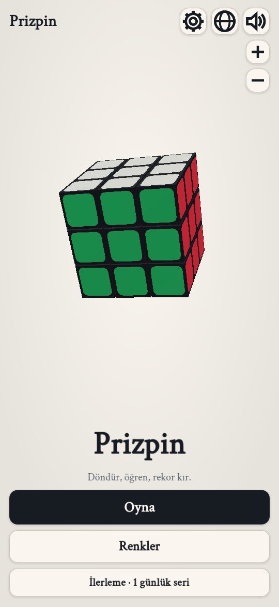
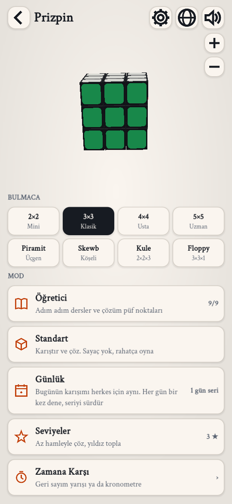
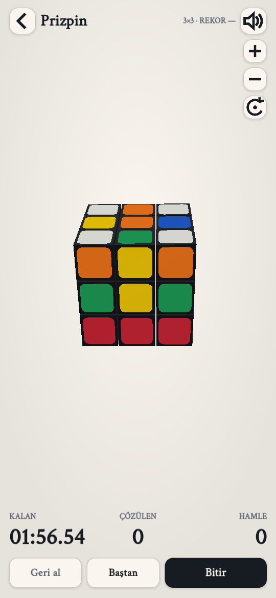
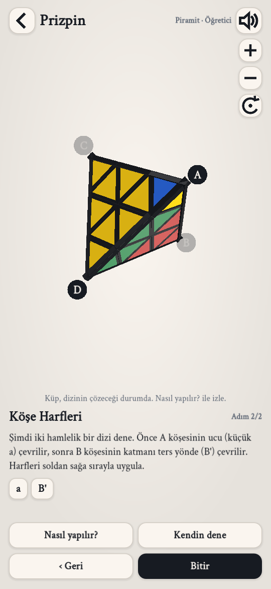

# Prizpin

**Döndür, öğren, rekor kır.** Telefonlar için 3 boyutlu bulmaca oyunu.

## Oyunu telefona kur (Android)

1. Telefonundan **[Prizpin.apk](https://github.com/gktglhn18/Prizpin/raw/main/Prizpin.apk)** dosyasını indir.
2. İndirilen dosyaya dokun. Telefon "bilinmeyen kaynaklardan yükleme" izni isterse ver.
3. **Yükle**'ye bas, sonra oyunu aç.

> iPhone için şimdilik kurulum dosyası yok (iPhone sürümü için Mac ve Apple geliştirici hesabı gerekiyor).

## İçindekiler

- **8 bulmaca:** 2×2, 3×3, 4×4, 5×5, Piramit, Skewb, Kule (2×2×3), Floppy (3×3×1)
- **Modlar:** Öğretici (44 ders), Standart, Günlük karışım, 20 seviye (yıldızlı), Geri Sayım Yarışı, Kronometre
- İpucu, geri al, kendi renklerini seçme, açık/koyu tema, ses ve titreşim
- **9 dil:** Türkçe, English, 中文, हिन्दी, Español, Deutsch, Italiano, Português, Русский
- Parmakla katman çevirme, boş alanı kaydırarak döndürme, iki parmakla yakınlaştırma

## Geliştirme

Oyun [Godot 4.7](https://godotengine.org) ile yapıldı. Kaynak kodu `prizpin-godot/` klasöründe:

| Dosya | Görevi |
|---|---|
| `game.gd` | Oyun akışı, modlar, dokunma, kamera |
| `screens.gd` | Menüler ve ekranlar |
| `ui_kit.gd` | Renkler, düğmeler, simgeler |
| `puzzle.gd` | 8 bulmacanın motoru |
| `loc.gd`, `data/` | Çeviriler ve dersler |
| `store.gd` | Kayıtlar (rekorlar, seri, yıldızlar) |
| `snd.gd` | Kodla üretilen sesler |

Açmak için Godot 4.7'de **Proje Yöneticisi → İçe Aktar** ile `prizpin-godot/project.godot` dosyasını seç.

Yazı tipi: Crimson Text (SIL Open Font License).
